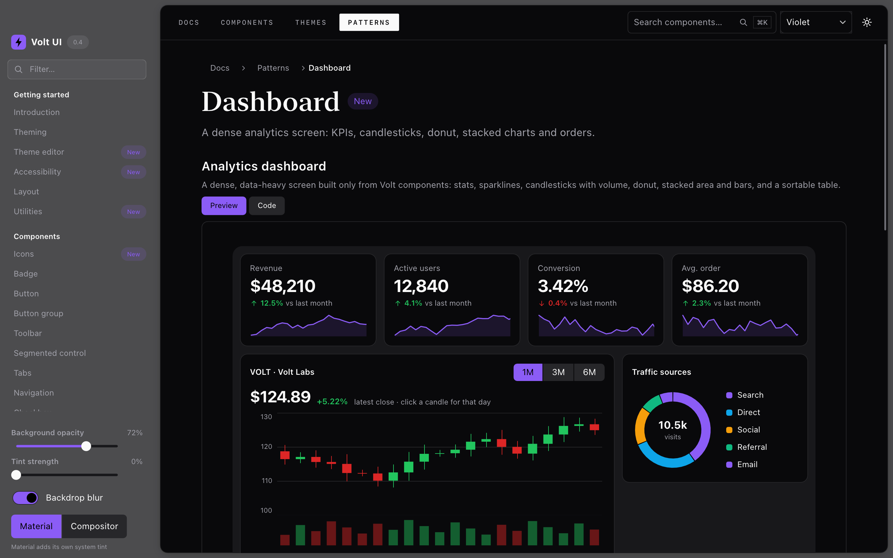
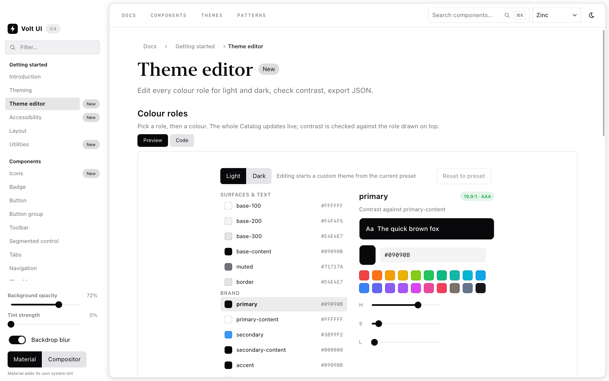

# Volt UI Kit

Native desktop interfaces in plain Rust, drawn on the GPU.

[Guides](docs/README.md) · [Documentation landing page](docs/index.html) ·
[Examples](examples/README.md) · [Contributing](CONTRIBUTING.md) · [Security](SECURITY.md)

**Pre-1.0:** macOS is the primary native platform. Rust 1.89+ is required;
Windows/Linux runtime acceptance and a browser host remain work in progress.

Write a function from your state to a tree of elements. Volt UI Kit lays it
out, draws it with [Vello](https://github.com/linebender/vello) on Metal, DX12
or Vulkan (with a CPU fallback), handles input, focus and accessibility, and
calls your closures when something happens. The Rust frontend needs no markup
language or webview. The optional JSON frontend is data-only; application
behavior stays in Rust.



```rust
use volt_ui_kit::{native::Application, ui::prelude::*};

#[derive(Default)]
struct App {
    count: u32,
}

fn view(app: &App) -> Element<App> {
    vstack![
        text(format!("Clicked {} times", app.count)).font_size(24.),
        button("Click me")
            .key("add")
            .variant(ButtonVariant::Primary)
            .on_click(|app: &mut App| app.count += 1),
    ]
    .padding(24., Edge::All)
    .gap(12., Axis::Vertical)
    .into()
}

fn main() -> Result<(), Box<dyn std::error::Error>> {
    Application::new("Counter", App::default(), view).run()
}
```

## Try the complete Catalog

From a checkout of this repository:

```sh
./scripts/run_catalog.sh
```

Builds and opens the full GPU Catalog, including macOS desktop services and
local notifications, with app packaging handled automatically. Permission is
requested only when you click the notification permission button. Use
`--check` to build/verify without opening it. Requires Cargo, Python 3 and, on
macOS, the command-line tools. Individual library features remain optional.

## Highlights

- **Plain Rust.** Views are functions and callbacks are closures over your own
  state type. Conditionals, loops and reusable components are ordinary Rust.
- **Application components.** Buttons, fields, selects, date pickers, menus, dialogs,
  command palettes, tables, trees, virtual lists, split panes, toasts and
  interactive charts.
- **Themes you define.** Every colour role is yours to set, from code or a JSON
  theme file that reloads live, with contrast checks built in. Bring any SVG
  icon set.
- **GPU first.** Vello renders on the GPU through wgpu, falls back to the CPU
  automatically. Rendering is event-driven; animations and application tasks
  can still wake the app.
- **Desktop integration.** Window chrome and blur, native menus and tray, file
  panels, notifications, commands with shortcuts, close guards and `.app`
  bundles (macOS first).
- **Accessible.** Roles, labels, values and actions go to screen readers
  through AccessKit, with full keyboard navigation.
- **A fast dev loop.** `cargo volt dev` rebuilds on save and restarts the app
  with its state and window position intact.



## Try it

```sh
git clone https://github.com/danieldear/volt-ui-kit
cd volt-ui-kit
./scripts/run_catalog.sh
```

The launcher enables all demo capabilities and handles the identified macOS
app bundle required by local notifications. It does not request permission or
send a notification automatically. Run it from a **repository checkout**, not
an extracted crates.io source package; source-maintenance scripts are not
shipped in the crate.

For targeted component development, direct Cargo launches accept example
arguments after `--`:

```sh
cargo run --release --locked --features native-gpu,native-desktop --example catalog -- --page dashboard --theme dark --accent violet
```

Direct launches do not package an app: the command above supports GPU drawing,
menus and file panels, but not the local-notification demo. Adding
`native-notifications` alone is not enough on macOS; use the launcher for that
end-to-end test. For software-only component testing, use `--features native`.
See [examples](examples/README.md#catalog-launch-modes) for the launch modes.

## Use it

Version **0.5.0** is prepared in this repository but is **not published on
crates.io**. Until publication, depend on it from Git:

```toml
[dependencies]
volt-ui-kit = { git = "https://github.com/danieldear/volt-ui-kit", features = ["native-gpu"] }
```

For reproducible applications, pin the Git dependency to a reviewed commit
with `rev = "<full-commit-sha>"` and commit `Cargo.lock`. No crates.io release
or stable API is implied by the current package version.

Or start from a template (the generator currently requires a local checkout
via `--kit-path`, even if the CLI was installed from Git):

```sh
cargo install --locked --git https://github.com/danieldear/volt-ui-kit --features dev-tools --bin cargo-volt
cargo volt new my-app --kit-path /path/to/volt-ui-kit --template navigation
cargo volt dev my-app
```

| Feature | Adds |
| --- | --- |
| `native` | A window with software drawing, text, images, clipboard, IME and accessibility |
| `native-gpu` | GPU drawing with Vello (implies `native`) |
| `native-desktop` | macOS menus, tray and file panels |
| `native-notifications` | macOS local notifications |
| `rust-ui` / `declarative` | The builders and runtime without a window, for custom hosts |
| `dev-tools` | The `cargo volt` command |

Rust 1.89 or newer.

## Status

Version 0.5.0, pre-1.0. macOS is the primary platform and is tested on Apple
silicon. Windows and Linux have local cross-compilation checks and a configured
headless CI matrix; their native runtime has not been validated yet. Check
[Actions](https://github.com/danieldear/volt-ui-kit/actions) for actual remote
results; configured jobs are not evidence of a passing run. The core compiles to
WebAssembly; a web host is planned. Expect API changes before 1.0.

## Documentation

- [Getting started](docs/getting-started.md)
- [Building interfaces](docs/building-uis.md)
- [Components](docs/components.md)
- [Styling and themes](docs/styling-and-themes.md)
- [Windows and rendering](docs/windows-and-rendering.md)
- [Application services](docs/app-services.md)
- [JSON interfaces](docs/json-ui.md)
- [Architecture](docs/architecture.md)
- [Examples](examples/README.md) · [Roadmap](ROADMAP.md) · [Changelog](CHANGELOG.md) · [Contributing](CONTRIBUTING.md)

## Preview the documentation site

```sh
python3 -m http.server 8000 --bind 127.0.0.1 --directory docs
# Open http://127.0.0.1:8000
```

The site uses local assets, an OFL-licensed display font, system interface
fonts and no JavaScript or analytics.
GitHub Pages publishing is a separate, manual maintainer step; see the
[public-release checklist](docs/public-release.md). The landing page leads to
the [component reference](docs/reference/index.html) and eight HTML how-to guides.
The reference includes source-backed Rust excerpts, API notes and toolkit-rendered
previews. See [site maintenance](docs/site-maintenance.md) to regenerate them.

## Security and maintenance

Report vulnerabilities using the [security policy](SECURITY.md), not public
issues. Dependency alerts, scheduled advisory checks, redacted history scans
and SHA-pinned workflows help maintain the project; they do not certify that
application code or native dependencies are free of vulnerabilities.

## License

MIT. See [LICENSE](LICENSE) and [third-party notes](docs/third-party.md).

## Publishing

A merged PR, package version or Git tag does not upload a crate. Maintainers:
follow the [crates.io publication checklist](docs/public-release.md#publish-the-crate)
for package verification, account prerequisites and the separately approved
`cargo publish` operation. `cargo push` is not a Cargo command.
